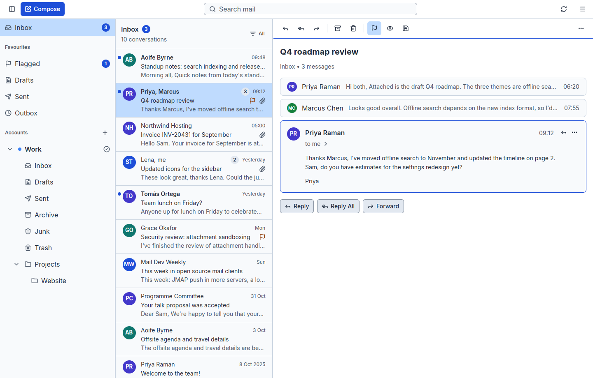
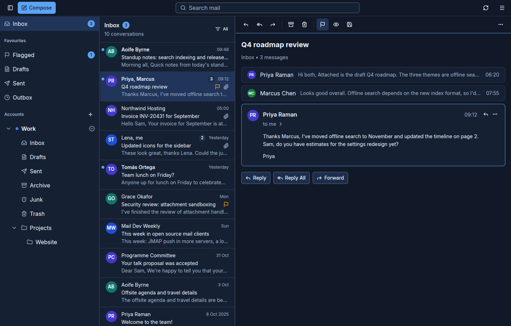

# Zmail

Zmail is a fast, local-first email client for the desktop and the terminal, written in Rust. It speaks IMAP, JMAP and SMTP, keeps an encrypted copy of your mail on your computer so browsing never waits for the network, and treats every message as untrusted. The desktop app is built on GPUI and reads unchanged Zed theme files; the terminal UI works like Pine and Alpine.

> [!NOTE]
> **Zmail is beta software.** Reading, searching and sending mail over IMAP, JMAP and SMTP, the encrypted local store, the desktop app on macOS, Windows and Linux, and the terminal UI all work and are tested in CI against live test mail servers, but expect bugs and some changes between releases. Keep your mail on the server and back up anything that matters; native Proton Mail support is still marked Experimental.

<p>
  
  
</p>

The terminal UI (`zmail-app tui`), on the same store and accounts:

```text
  ZMAIL 0.0.0-test               MESSAGE INDEX       Folder: INBOX  Conv 1 of 4
  N*        11:35  Grace Hopper         (2) Launch plan for the terminal UI
  N     Yesterday  Harbour News         Harbour newsletter, issue 42
    @         Mon  山田 太郎            東京オフィスの会議 📅 next week
           25 Sep  Billing              Invoice fdp.exe

                  [Folder "INBOX" opened with 4 conversations]
? Help       > [ViewMsg]  N NextMsg    Spc NextPage U Undo       F Forward
< FldrList   P PrevMsg    - PrevPage   D Delete     R Reply      O OTHER CMDS
```

Screenshots and the terminal snapshot show synthetic test mail: the desktop ones from the UI screenshot matrix, captured for each release ([how they are kept current](./docs/site.md#screenshots)), the terminal one from the terminal UI's snapshot tests (an 80x24 screen, empty rows left out).

## Download

Get the latest release from **[GitHub Releases](https://github.com/unicornops/zmail/releases/latest)**:

| System | File |
| --- | --- |
| macOS (Apple silicon) | `Zmail-<version>.dmg` (signed and notarised), or `zmail-macos.app.zip`; `zmail-macos.tar.gz` is the `zmail-app` binary alone, handy for the terminal UI |
| Windows (x86-64) | `zmail-windows-x86_64.msi` (installer), or `zmail-windows-x86_64.zip` |
| Debian and Ubuntu (x86-64) | `zmail-linux-x86_64.deb` |
| Other Linux (x86-64) | `zmail-linux-x86_64.tar.gz` |

Each release also has `SHA256SUMS-Linux`, `SHA256SUMS-macOS` and `SHA256SUMS-Windows`, and every file has a build provenance attestation you can check with `gh attestation verify FILE --repo unicornops/zmail`. The Windows and Linux downloads are not signed. [Installing Zmail](./docs/install.md) explains each file, how to check a download, HTML mail on Linux, upgrading, and where Zmail keeps its data.

## Features

- Desktop app for macOS, Windows and Linux, and a terminal UI, sharing one store and one set of accounts.
- IMAP, JMAP and SMTP, with OAuth2 sign-in; account setup finds the server settings and tests the sign-in before saving. Native Proton Mail accounts (paid plans) are Experimental.
- Local-first: the mail is mirrored into a SQLCipher-encrypted store, so browsing, search and mail actions never wait for the network; sync and sending run in the background.
- Full-text search with operators such as `from:`, `has:attachment` and `after:30d`, asking the server too until every message is indexed.
- HTML mail in a locked-down web view with remote content blocked until you allow it, or as plain text; sender-safety warnings for look-alike domains and misleading names.
- Compose with drafts, attachments, undo-send and an outbox; multiple identities.
- Passwords and the store key in the system keychain; no telemetry.

[What Zmail has](./docs/features.md) is the full list.

## Quick start

1. Install Zmail from the [latest release](https://github.com/unicornops/zmail/releases/latest).
2. Start it from your applications menu or Start menu, or run `zmail-app`. With no account yet, it shows a welcome screen: choose your provider and sign in, and Zmail finds the server settings, tests the connection, saves the account and starts the first sync.
3. Gmail needs an app password or an OAuth client of your own; the Add Account flow explains both.
4. For the terminal UI, run `zmail-app tui`; `S` on its Main Menu adds an account.

Zmail needs the system keychain: Keychain on macOS, Credential Manager on Windows, or a Secret Service such as GNOME Keyring or KWallet on Linux. Over SSH, see [Using Zmail over SSH or on a headless machine](./docs/install.md#using-zmail-over-ssh-or-on-a-headless-machine).

## Documentation

The documentation is published at [docs.zmail.unicornops.ie](https://docs.zmail.unicornops.ie/) (the latest release, with `main` under `/dev/`), built from the pages below.

| Read | For |
| --- | --- |
| [Installing Zmail](./docs/install.md) | downloads, checking them, first run, upgrading, SSH and headless machines, where data is kept, platform notes |
| [What Zmail has](./docs/features.md) | the full feature list, and Settings → Mail |
| [Terminal UI](./docs/tui.md) | keys, triage, compose, accounts, and the keymap file for your own keys |
| [The command line](./docs/cli.md) | every `zmail-app` command, with examples |
| [Searching mail](./docs/search.md) | the search language, search scope and server search |
| [Gmail with your own OAuth client](./docs/gmail-oauth.md) | signing in to Gmail with OAuth |
| [Development](./docs/development.md) | building from source, tests, the live mail harness, UI screenshots, design documents |
| [Architecture decisions](./docs/adr/) | the ADRs: JMAP, GPUI pin, Proton Mail, store encryption, HTML mail, terminal UI |
| [Performance](./docs/performance.md) | performance budgets and the latest numbers |
| [Hardening and release policy](./docs/phase5-hardening.md) | accessibility, crash reporting, packaging, signing and releases |
| [Security policy](./SECURITY.md) | how to report a vulnerability |
| [Changelog](./CHANGELOG.md) | what changed in each release |

## Licence

Zmail is licensed under GPL-3.0-only. Dependency policy is enforced through [`deny.toml`](./deny.toml) and prepared for `cargo-about` via [`about.toml`](./about.toml).

Linux builds embed the [Inter](https://rsms.me/inter/) UI font (4.1, SIL Open Font License 1.1, [`assets/fonts/inter/LICENSE.txt`](./assets/fonts/inter/LICENSE.txt)); the `.deb` installs its licence under `/usr/share/doc/zmail-app/`. All builds embed [Lucide](https://lucide.dev) icons (ISC, with the Feather-derived icons also under MIT, [`assets/icons/LICENSE.txt`](./assets/icons/LICENSE.txt)), and code ported from GPUI is Apache-2.0 ([`crates/zmail-ui/LICENSE-APACHE`](./crates/zmail-ui/LICENSE-APACHE)). The local store is encrypted with [SQLCipher](https://www.zetetic.net/sqlcipher/) (BSD-3-Clause, [`crates/zmail-store/LICENSE-SQLCIPHER`](./crates/zmail-store/LICENSE-SQLCIPHER)), which on Linux and Windows links a statically built OpenSSL (Apache-2.0, [`crates/zmail-store/LICENSE-OPENSSL`](./crates/zmail-store/LICENSE-OPENSSL)); see [ADR 0005](./docs/adr/0005-store-encryption.md). Bundled non-crate assets and ported source files are listed in [`about.toml`](./about.toml).
