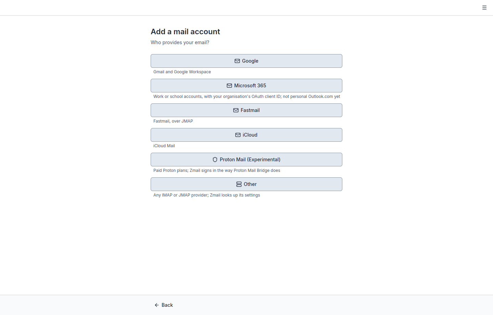

# Installing Zmail

How to download and check Zmail, run it for the first time, upgrade it, use it over SSH, and where it keeps its data. To build it yourself, see [Development](./development.md).

## Install

Releases are on the [Releases page](https://github.com/unicornops/zmail/releases). Pick the asset for your system:

| System | Asset | Notes |
| --- | --- | --- |
| macOS | `Zmail-<version>.dmg` | Open it and drag Zmail to Applications. |
| macOS | `zmail-macos.app.zip` | The same app in a zip. |
| macOS | `zmail-macos.tar.gz` | Only the `zmail-app` binary, handy for the terminal UI. |
| Debian and Ubuntu (x86-64) | `zmail-linux-x86_64.deb` | `sudo apt install ./zmail-linux-x86_64.deb`. Installs `zmail-app`, a desktop entry and the AppArmor profile described below. |
| Other Linux (x86-64) | `zmail-linux-x86_64.tar.gz` | `zmail-app`, `LICENSE` and `licenses/`. Unpack it and put `zmail-app` on your `PATH`. |
| Windows (x86-64) | `zmail-windows-x86_64.msi` | The installer. |
| Windows (x86-64) | `zmail-windows-x86_64.zip` | `zmail-app.exe` without an installer. |

The macOS assets are built on an Apple silicon runner; their names do not say so. Apart from the DMG, asset names carry no version, so keep track of the release tag you downloaded from.

The Linux assets need glibc 2.39 or newer (Ubuntu 24.04, Debian 13 or later); 0.34.0 and 0.34.1 needed glibc 2.43 by mistake and do not start on Ubuntu 24.04 ([#483](https://github.com/unicornops/zmail/issues/483)).

## Check your download

**Checksums.** Each release has `SHA256SUMS-Linux`, `SHA256SUMS-macOS` and `SHA256SUMS-Windows`, listing the assets built on that system (and, from releases after 0.34.4, `SHA256SUMS-Screenshots` for the screenshots it also publishes: `zmail-linux-screenshot.png` and the documentation's `zmail-docs-*.png`). Download the one for your asset into the same folder, then check just that file:

```bash
grep zmail-linux-x86_64.deb SHA256SUMS-Linux | sha256sum --check          # Linux
grep zmail-macos.tar.gz SHA256SUMS-macOS | shasum -a 256 --check          # macOS
```

On Windows, compare the output of `Get-FileHash .\zmail-windows-x86_64.msi` (PowerShell) with the line in `SHA256SUMS-Windows`. A checksum from the same release page shows the download is intact. It does not show who built it.

**Build provenance.** Every release asset, the `SHA256SUMS-*` files included, also has a build provenance attestation, made by the release workflow and signed through Sigstore with that run's GitHub identity. It shows that the file was built by `unicornops/zmail`'s release workflow on GitHub Actions, and from which commit, which a checksum from the same page cannot. Check it with the [GitHub CLI](https://cli.github.com/) (`gh`), from the folder you downloaded to:

```bash
gh attestation verify zmail-linux-x86_64.deb --repo unicornops/zmail       # Linux
gh attestation verify Zmail-0.34.1.dmg --repo unicornops/zmail             # macOS (use your version)
gh attestation verify zmail-windows-x86_64.msi --repo unicornops/zmail     # Windows
```

It exits with status 0 when the file matches an attestation from this repository, and fails (with an HTTP 404 for a file nobody attested) otherwise. Add `--format json` to see the workflow, commit and tag the file was built from. Any other asset name from the table above works the same way.

**What is signed.**

- The macOS DMG is signed with an Apple Developer ID and notarised by Apple.
- The Windows MSI and zip are **not** signed. Windows SmartScreen warns about an unknown publisher; that is expected, and the checksum and attestation above are your check.
- The `.deb` and the Linux tarball are **not** signed.

**HTML mail on Linux** needs the `libwebkit2gtk-4.1-0` package (the `.deb` recommends it) and, on Ubuntu 24.04, an AppArmor profile that lets its sandbox start. The `.deb` installs and loads the profile. With the tarball, copy [`crates/zmail-app/packaging/apparmor/zmail`](../crates/zmail-app/packaging/apparmor/zmail) to `/etc/apparmor.d/zmail` and run `sudo apparmor_parser -r /etc/apparmor.d/zmail`. Without it, mail shows as plain text and Zmail says why. [Platform notes](#platform-notes) below has the details.

## First run

Start the desktop app from your applications menu or Start menu, or run `zmail-app` with no arguments. With no account yet, the window shows a welcome screen: choose your provider, sign in, and Zmail finds the server settings, tests the connection, saves the account and starts the first sync. Gmail needs an app password or an OAuth client of your own, and the Add Account flow explains both (see also [Gmail with your own Google OAuth client](./gmail-oauth.md)). Add more accounts later from the sidebar, the menus or Settings.



For the terminal UI, run `zmail-app tui` (on macOS the `zmail-macos.tar.gz` binary is the easy way to get `zmail-app`). With no account yet, it opens on the Main Menu and `S` goes straight to adding one; the steps are the desktop app's (see [Terminal UI](./tui.md#accounts)). The desktop app and the terminal UI share one store and one set of accounts.

Zmail needs the system keychain (Keychain on macOS, Credential Manager on Windows, a Secret Service such as GNOME Keyring or KWallet on Linux). It holds the key that unlocks the local store and your account passwords.

## Upgrade

Zmail does not update itself yet. Your accounts and mail stay in the data directory (see [Where Zmail keeps its data](#where-zmail-keeps-its-data)), and the store is migrated when the new version first opens it. Close every Zmail window and `zmail-app tui` first, and copy the data directory somewhere safe if the mail in it matters: going back to an older version is not supported.

- **macOS DMG or zip:** replace Zmail in Applications with the new one.
- **`.deb`:** download the new `.deb` and run `sudo apt install ./zmail-linux-x86_64.deb` again.
- **Linux tarball:** unpack the new one over the old `zmail-app`. If you added the AppArmor profile by hand, copy the repository's current one when it changes.
- **Windows:** run the new MSI, or replace `zmail-app.exe` from the zip.
- **From source:** `git pull`, then build again (see [Development](./development.md)).

## Using Zmail over SSH or on a headless machine

Zmail keeps its store key and account secrets in the OS keychain and has no passphrase or plaintext fallback. Over SSH to a Linux machine with no desktop login there is no Secret Service, so `zmail-app tui` stops and says the keychain did not answer.

[`scripts/zmail-tui-headless.sh`](../scripts/zmail-tui-headless.sh) is a launcher for that case. It starts a private D-Bus session and gnome-keyring on it, asks for a keyring password (you choose it on first run; it is never stored), then runs `zmail-app tui`. It needs `dbus-daemon`, `busctl`, `gnome-keyring` and `flock`:

```bash
sudo apt install dbus-daemon gnome-keyring      # Debian and Ubuntu
scripts/zmail-tui-headless.sh                   # start the terminal UI
scripts/zmail-tui-headless.sh --status          # show the bus and keyring state
scripts/zmail-tui-headless.sh --lock            # lock the keyring and stop the bus
```

The script is not in the release archives; copy it from this repository to the machine. The trade-off: the keyring stays unlocked until you run `--lock` or the machine restarts, so any process running as your user can read Zmail's secrets in that time. Lock it when you are done on a shared machine. Browser sign-in (OAuth) cannot reach a Zmail running over SSH, so add such accounts on a computer with a browser, or use an app password.

## Where Zmail keeps its data

The local store lives in a platform data directory, independent of the launch directory:

- Linux: `$XDG_DATA_HOME/zmail` (default `~/.local/share/zmail`)
- macOS: `~/Library/Application Support/zmail`
- Windows: `%APPDATA%\zmail`

Set the `ZMAIL_DATA_DIR` environment variable to override the store directory. Each store keeps its own account passwords and sign-ins in the system keychain, named by an id the store keeps, so stores in different directories (or a new store after `zmail-app reset-store`) never read, replace or remove each other's, even though their accounts are numbered alike. Copying a store's directory copies its id: the copy and the original then share their keychain entries, so make a new store rather than a copy when you want a second one. A legacy `.zmail-dev/zmail.sqlite3` store in the current directory is migrated to the platform data directory on first run; if the migration fails, the app keeps using the legacy store so no data is lost.

## Platform notes

HTML mail on Linux ([ADR 0006](./adr/0006-html-email-renderer.md)) uses WebKitGTK 4.1 at runtime; nothing is needed to build. To see formatted mail, install `libwebkit2gtk-4.1-0` (Debian 13, Ubuntu 24.04 and later; `webkit2gtk4.1` on Fedora). Its sandbox, bubblewrap, needs unprivileged user namespaces: it works on Debian, Fedora and Ubuntu 26.04, but not in most containers, and Ubuntu 24.04 allows them only to programs with an AppArmor profile that grants them. The `.deb` installs one for `/usr/bin/zmail-app` (`/etc/apparmor.d/zmail`, which confines nothing and only allows user namespaces, like the profiles Ubuntu ships for Epiphany); a tarball install on Ubuntu 24.04 needs the same profile, from `crates/zmail-app/packaging/apparmor/zmail`, copied to `/etc/apparmor.d/zmail` and loaded with `sudo apparmor_parser -r /etc/apparmor.d/zmail`. The `.deb` loads it when it is installed (if AppArmor is present; on other systems nothing happens) and unloads it when Zmail is removed. Where the sandbox cannot start, Zmail shows mail as text and says why; it never runs the engine without it. `ZMAIL_WEB_DEBUG=1` logs each step of the web renderer.

Window chrome: Zmail draws its own title bar with the toolbar inside it. On macOS the system title bar is transparent around the traffic lights; on Windows the caption buttons are drawn (Snap Layouts still work); on Linux Zmail draws a header bar, shadow and resize edges (client-side decorations) on GNOME and other desktops, and keeps the window manager's title bar on KDE and on X11 without a compositor or `_GTK_FRAME_EXTENTS` support. `ZMAIL_WINDOW_DECORATIONS=server` or `=client` overrides the choice (GNOME on Wayland has no server-side decorations, so it always gets the drawn ones).

GPUI draws through wgpu, which needs a Vulkan driver (the `libvulkan1` loader plus Mesa or a vendor driver) or, as a fallback, EGL/OpenGL at runtime. Desktop distributions ship these already; headless runs such as the release screenshot use Mesa's lavapipe software driver (`mesa-vulkan-drivers`).
