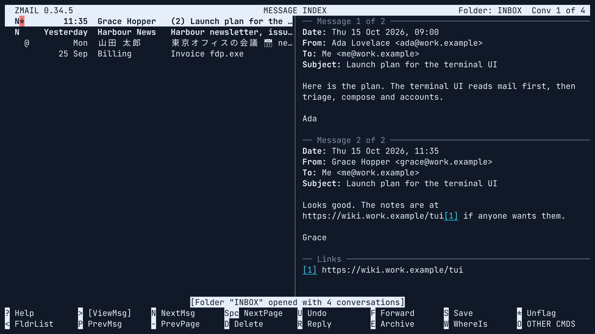
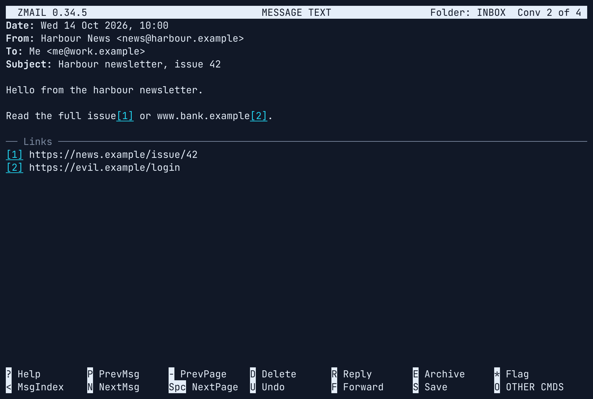
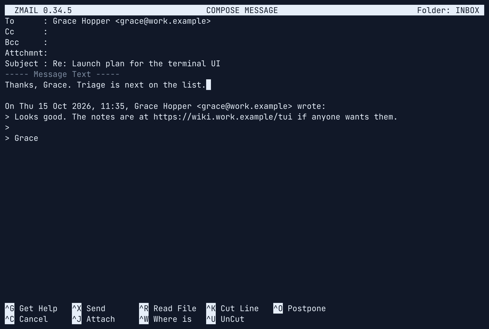

# Terminal UI

Read, triage and write mail, and set accounts up, in a terminal, on the same store as the desktop app ([ADR 0007](./adr/0007-terminal-ui.md)):

```bash
zmail-app tui
zmail-app launch-tui-fixture   # synthetic mail, no sync, nothing saved, a keychain in memory
```

From a source checkout, use `cargo run -p zmail-app -- tui` and so on.

It is in every build (the `tui` feature, on by default) and unlocks the store with its key from the system keychain, like the desktop app; over SSH that needs the keychain service running on that machine (Secret Service on Linux), or it says so and stops; see [Using Zmail over SSH or on a headless machine](./install.md#using-zmail-over-ssh-or-on-a-headless-machine) for a launcher. With no account yet, the status line says so and, on the Main Menu where it starts, `S` goes straight to adding one (later accounts: `S`, then `A` for Accounts, then `A`).

<p>
  
</p>
<p>
  
  
</p>

The same Message Index as text, at 80x24 (from its snapshot test, with the empty rows left out):

```text
  ZMAIL 0.0.0-test               MESSAGE INDEX       Folder: INBOX  Conv 1 of 4
  N*        11:35  Grace Hopper         (2) Launch plan for the terminal UI
  N     Yesterday  Harbour News         Harbour newsletter, issue 42
    @         Mon  山田 太郎            東京オフィスの会議 📅 next week
           25 Sep  Billing              Invoice fdp.exe
                  [Folder "INBOX" opened with 4 conversations]
? Help       > [ViewMsg]  N NextMsg    Spc NextPage U Undo       F Forward
< FldrList   P PrevMsg    - PrevPage   D Delete     R Reply      O OTHER CMDS
```

The screenshots and text show synthetic test mail. Every screen has text snapshots at 80x24 and 160x48 in [`crates/zmail-tui/src/snapshots`](../crates/zmail-tui/src/snapshots), drawn from the same synthetic mail; they show what each screen looks like. The screenshots are made from those tests too, in a dark terminal with fixed colours, so a terminal with another colour scheme or font looks different ([how they are made](./site.md#terminal-ui-screenshots)).

## Screens and keys

The screens work like Pine and Alpine: a title bar, the screen, a status line, and a command bar that lists the keys that work there (`O` shows more). Letters work in either case.

| Key | Does |
| --- | --- |
| `M` | Main Menu |
| `L` | Folder List (each account is a collection) |
| `I` | Message Index of the current folder |
| `<` / `>`, Enter | up a level, open |
| `P` / `N` | previous and next item (or message, in Message Text) |
| `-` / Space | previous and next page |
| `W` | WhereIs: search the index as you type (the [search language](./search.md#the-search-language); Enter also asks the server), find a folder, or find text in a message |
| `/` | list conversations or single messages |
| `V` | preview pane beside the index, in terminals 120 columns or wider |
| Tab, Enter | in Message Text, move to a numbered link and open it after seeing its real address |
| `V` | in Message Text, the Attachment Index: the conversation's attachments (name, type, size), to save |
| `C` | compose (wherever `C` is free); `R` reply and `F` forward in the Message Index and Message Text |
| `T` | the Outbox (from the Main Menu; also under Local in the Folder List) |
| `S` | Setup (from the Main Menu; with no account yet it goes straight to adding one); `A` there opens Accounts |
| `:` | the command palette: every command of the screen with its key, filtered as you type (the desktop app's fuzzy matcher), Enter runs one; not in Compose or the account forms, where `:` is text |
| `Q` | quit, after asking |

## Triage

**Triage** works in the Message Index on the message under the cursor and in Message Text on the open one. Each command acts on the whole conversation, as in the desktop app (also when the index lists single messages), and the status line says what it did with its undo key ("Conversation moved to Trash. U Undo").

| Key | Does |
| --- | --- |
| `D` | delete: to the Trash at once (for good, with no undo, when the account has no Trash); in Message Text, the next message opens |
| `E` | archive |
| `S` | save to a folder of the same account: Tab completes the name and then goes through the matches, `Ctrl-T` lists the folders to pick from |
| `*` | flag, or unflag |
| `K` | mark read, or unread |
| `U` or `Z` | undo the last of these, whichever screen it was done on |
| `;` | select the message under the cursor, or not (an `X` in the first column) |
| `A` | apply the next command (`D`, `E`, `S`, `*` or `K`) to every selected message; `;` there unselects them all |

Opening a message in Message Text marks it read once it has been open for 1.5 seconds, as the desktop app's reader does. The changes go through the same mail actions as the desktop app (`zmail-actions`): each is written to the store at once and sent to the server by whichever Zmail syncs.

## Sender-safety warnings

**Sender-safety warnings** appear above a message's text in Message Text (and the preview pane), with the desktop app's words and evidence from the same code (`zmail_security::sender_warning`): "Possible impersonation" for a sender's domain that imitates a well-known one (with look-alike letters from other alphabets too), "Name shows another address" for a display name that shows an address or website on another domain, "Mixed alphabets in the sender's domain", "Replies go somewhere else" for a Reply-To on an unrelated domain, and "Sent through a mailing list" (a name like `'alice@example.com' via Dev Team` sent from the list), "Replies go to a related address" and "International sender domain" (all three left out with the desktop app's "Fewer warnings" setting). `X` (Looks safe, on the first page of the command bar while a warning shows) hides the warning in view for that message only, as the desktop app's button does, in both frontends.

## Attachments

**Attachments** are saved from the Attachment Index (`V` in Message Text). `S` or Enter saves the one under the cursor: the path starts in the folder last saved to (else Downloads, else the home folder) with the attachment's name made safe for a file (`zmail_security::attachment_safety`), Tab completes it, and a folder there saves into that folder. A file that is already there is replaced only after asking. `A` saves them all into a folder, numbering a name that is taken (`report (1).pdf`), as the desktop app's Save All does. The attachment is decrypted to a temporary file beside the destination and renamed into place (`AttachmentBlob::save_to`), so a failed save leaves nothing partial. Names and types from the mail are filtered before they are drawn. The terminal never opens or launches an attachment: save it, and open it yourself.

## Writing mail

**Writing mail** works like Pico: header fields (From when the account has several addresses, To, Cc, Bcc, Attchmnt, Subject), then the message text in an editor (`ratatui-textarea`). Up and Down, Enter and Tab move between the fields; Tab in To, Cc and Bcc completes an address from the ones you have used (the desktop app's suggestions, best first), again to go through the matches. `C` asks "Continue postponed composition?" when there are postponed messages. `R` replies to the message (in Message Text, the newest one that starts on screen), asking "Reply to all recipients?" when others got it too; `F` forwards it. Replies and forwards start exactly as in the desktop app (`zmail_actions::reply`: recipients, `Re:`/`Fwd:`, the quote or the forwarded headers), with the quoted text filtered for the terminal before it enters the editor. As in the desktop app, a reply goes to the message's `Reply-To` when it has one, comes from the address the message was sent to (an alias included; change it in From), and names the message it answers in `In-Reply-To` and `References`, so it threads for the recipients; a forward takes the message's attachments along, to keep or remove.

| Key | Does |
| --- | --- |
| `Ctrl-X` | send, after asking; the message waits for the undo-send delay set in the desktop app, and until then `U` takes it back and opens it again |
| `Ctrl-O` | postpone: keep the draft for later |
| `Ctrl-C` | cancel: deletes the draft, after asking if you changed it (an unchanged postponed draft stays) |
| `Ctrl-K` / `Ctrl-U` | cut the line (a header field's text, or the attachment under the cursor on Attchmnt), put back what was cut |
| `Ctrl-J` or `Ctrl-A` | attach a file: its path, with Tab completion, or `Ctrl-T` to browse. Windows shows `^A` on the command bar, where `Ctrl-J` may arrive as Enter |
| `Ctrl-R` | insert a file's text into the message |
| `Ctrl-W` | find text in the message |
| `Ctrl-T` | your addresses (most used first) in To, Cc and Bcc; the file browser on Attchmnt |
| `Ctrl-G` | help |
| `Ctrl-_` | edit the message text in `$VISUAL` or `$EDITOR` (most terminals send the same key for `Ctrl-7` and `Ctrl-/`), only when Setup turns it on |

The external editor is off by default. Setup says what turning it on means: while the editor is open, the draft is unencrypted in a temporary file, in a new folder only you can open (0700 on Unix, the file 0600; on Windows your own temporary folder), and Zmail overwrites every file in that folder and removes it when the editor exits, also when it fails or never starts.

Drafts autosave to the encrypted store a second after typing pauses, as in the desktop app, and attachments are copied into it encrypted, shown by their filtered names and sizes. Send goes through the same path as the desktop app (`SyncService::queue_draft_and_send_after`), so whichever Zmail holds the sync lock sends it from the outbox. The **Outbox** (`T`) lists messages waiting to send and those that couldn't be sent, in the desktop app's words: `R` sends a failed one again, `D` takes back one that hasn't started sending (it returns to the postponed messages); a refused sign-in or a changed recipient key is settled in the desktop app. The postponed messages are listed under Local in the Folder List too, where Enter continues one and `D` deletes it.

## Accounts

**Accounts** (`S`, then `A`) is Alpine's collection list for mail accounts: `A` adds one, `C` changes the one under the cursor (a new password, the browser sign-in again for OAuth accounts, Proton's sign-in again for Proton accounts, the cache budget), `D` deletes it from this computer after asking (its local data and every keychain secret it has; the mail on the server stays). The steps of adding one are the desktop app's, from the same code (`zmail-setup`):

1. Your email address. Gmail, Outlook.com, Fastmail and iCloud addresses use Zmail's own settings; any other domain is looked up step by step, each step's progress on screen (DNS records, the domain's own setup file, JMAP, Mozilla's database only after asking, since that sends the domain to Mozilla, the domain's mail servers, the usual server names). `E` skips to typing the servers. With Proton built in, a Proton address (or `Ctrl-P`) goes to Proton's sign-in instead.
2. How you sign in: a password, an app password (with the provider's own hint and help page), or OAuth in the browser with a client of your own. Zmail ships no OAuth client; for Gmail the step lists how to make one in Google Cloud, as the desktop app's guide does. When the only servers found come from DNS records that point outside your mail domain (often a hosting provider's servers, but DNS answers can be forged), this step names them and goes on only once you press `Y` to use them, or `E` to type your servers instead.
3. The servers, found or guessed, all editable: host, port and security for IMAP and SMTP, or the JMAP session URL. TLS is the default; an unencrypted connection needs its own opt-in, with a warning.
4. For OAuth, the browser opens at the provider's sign-in page, and the address is always shown too, in full, to open by hand. The provider sends the sign-in back to `127.0.0.1` on the computer the browser runs on, so over SSH (`SSH_CONNECTION` or `SSH_TTY` set) it can't reach this Zmail; the terminal says so plainly and opens no browser: use an app password, or add the account on the computer you're at. Esc stops waiting and frees the port.
5. A connection test: Zmail signs in to the incoming server (IMAP, or the JMAP session) and the outgoing one (SMTP), sends nothing, and says which one failed and why, back on the step where it is fixed.
6. Your identity: the name and address mail goes out with, prefilled, and a signature.
7. Saved: the password goes to the system keychain and nowhere else, and the first sync starts here when this Zmail syncs, otherwise in the Zmail window that does (within seconds). The screen follows the first sync.

Proton sign-in (builds with Proton) asks for your Proton username and password, under the desktop app's note on what a third-party Proton client means (Zmail signs in as Proton Mail Bridge), then the two-factor code and the mailbox password when the account has them. When Proton asks for human verification, Zmail opens Proton's page in the browser (and shows its address) and signs in again once you press Enter.

To sign in to an account again without removing it, choose it in Accounts, press `C`, then Enter on the first row: a new password, the browser for OAuth accounts, or Proton's sign-in for a Proton account. For Proton, the address is the account's own and can't be changed. Whether Proton has ended Zmail's session or it still works (after you change your Proton password, say), once you have signed in Zmail signs the old session out and keeps the new one in the account's keychain slots, then syncs the account and sends again the messages refused for the old session. Its mail stays on this computer and nothing downloads again. Signing in as a different Proton account is refused, and the old session is left alone.

In the forms, Up, Down and Tab move between fields, Enter goes to the next one or continues from the last, Space changes a choice, `Ctrl-U` clears a field, Esc goes back a step and `Ctrl-C` cancels. Password fields show `[hidden]` once typed, never the text or its length. Everything a server, DNS or Proton returns (discovery results and errors, connection errors) is filtered for the terminal before it is drawn.

## Your own keys

**Your own keys.** A keymap file rebinds keys on each screen. It is `tui-keymap.json` in the store's folder (see [Where Zmail keeps its data](./install.md#where-zmail-keeps-its-data): `~/.local/share/zmail/tui-keymap.json` on Linux, `~/Library/Application Support/zmail/tui-keymap.json` on macOS, `%APPDATA%\zmail\tui-keymap.json` on Windows, or in `ZMAIL_DATA_DIR`), read when the terminal UI starts; Help (`?`) shows its path and what it binds. The format is the desktop app's keymap format (Zed's): a JSON array of sections, each with an optional `context`, the screen, and `bindings` from keys to commands:

```json
[
  { "context": "MessageIndex", "bindings": { "x": "Delete", "d": null } },
  { "context": "MessageText", "bindings": { "ctrl-s": "LooksSafe" } },
  { "bindings": { "ctrl-p": "Palette" } }
]
```

- Screens (`context`): `MainMenu`, `FolderList`, `MessageIndex`, `MessageText`, `AttachmentIndex`, `Setup`, `Help`, `Postponed`, `Outbox` and `Accounts`. A section without one applies on all of them, and a section for the screen wins over it. Compose and the account forms aren't keymapped: their keys are text.
- Keys as Zed writes them: `x`, `ctrl-x`, `alt-x`, `shift-tab`, `enter`, `space`, `tab`, `backspace`, `up`, `pageup`, `home`, `f1` to `f12`, or a character such as `<` or `*`. Letters work in either case. Esc and `ctrl-l` (redraw) are the terminal's own and can't be bound.
- Commands: `Help`, `Back`, `Select`, `Prev`, `Next`, `PageUp`, `PageDown`, `Home`, `End`, `WhereIs`, `Threads`, `Preview`, `MainMenu`, `FolderList`, `Index`, `Setup`, `Compose`, `Reply`, `Forward`, `Outbox`, `Retry`, `CancelSend`, `DeleteDraft`, `AddressBook`, `Quit`, `OtherCmds`, `NextLink`, `PrevLink`, `Mark`, `Copy`, `Delete`, `Undo`, `Archive`, `Save`, `Flag`, `ReadState`, `ToggleSelected`, `Apply`, `Accounts`, `AddAccount`, `ChangeAccount`, `DeleteAccount`, `Attachments`, `SaveAttachment`, `SaveAllAttachments`, `LooksSafe` and `Palette`. `null` makes the key do nothing on that screen.
- A key you bind replaces what Zmail had on it there; Zmail's other keys keep working. The command bar, the Main Menu, Help and the palette show your key for a command, and a command whose only key you took is left off the bar but stays in the palette (`:`). A command that doesn't work on a screen says so when its key is pressed.
- A file that isn't valid JSON, or names an unknown screen, key or command, is ignored as a whole (nothing of it applies), and the status line and Help say why; the terminal UI always starts.

## Mouse, copy and paste

The mouse works too: a click opens what it is on (a click on the index's first column selects), the wheel scrolls, and the command bar's entries can be clicked.

**Copy and paste** work as in Zellij. Drag to select text inside one pane (the preview pane and the index are separate); it is copied when you let go. Double-click selects a word, triple-click a line, and dragging past the top or bottom scrolls. Wrapped lines are copied as the line they came from. Without a mouse, `Ctrl-Space` sets a mark in Message Text, the arrow keys select, and `y` or `Ctrl-C` copies. Copies go to the clipboard with OSC 52 (iTerm2, kitty, WezTerm, Alacritty, foot, Windows Terminal; tmux needs `set-clipboard on`); on a Mac outside SSH they go through `pbcopy`, since Terminal.app has no OSC 52. Setup can set a copy command instead (`wl-copy`, `xclip -selection clipboard`; run without a shell), send OSC 52 to the primary selection, or turn the mouse off. Hold Shift while dragging to use the terminal's own selection. Pastes (bracketed paste) go only into text fields such as WhereIs and Compose's fields, as text (a list pasted into To, one address per line, becomes a comma list); anywhere else they are ignored, so pasted text never runs commands.

## One Zmail syncs a store

Only one Zmail process syncs a store at a time, through a lock beside it (`<store>.sync.lock`). When the desktop app is already open, the terminal UI shows what it syncs, says "Sync runs in another Zmail window", and takes sync over if the window closes first; the same holds the other way round. The command-line commands that sync or send respect the lock too (see [The command line](./cli.md#one-zmail-syncs-at-a-time)). New mail shows in the status line and rings the terminal bell (Setup turns the bell off).
